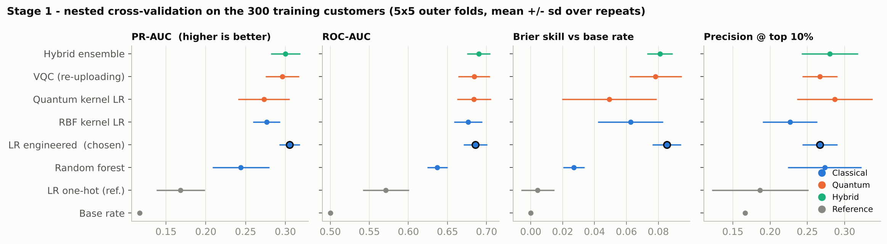
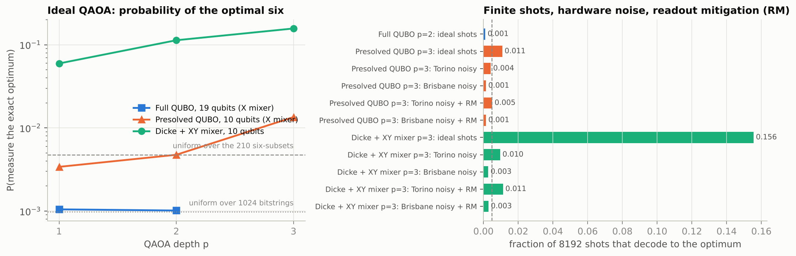
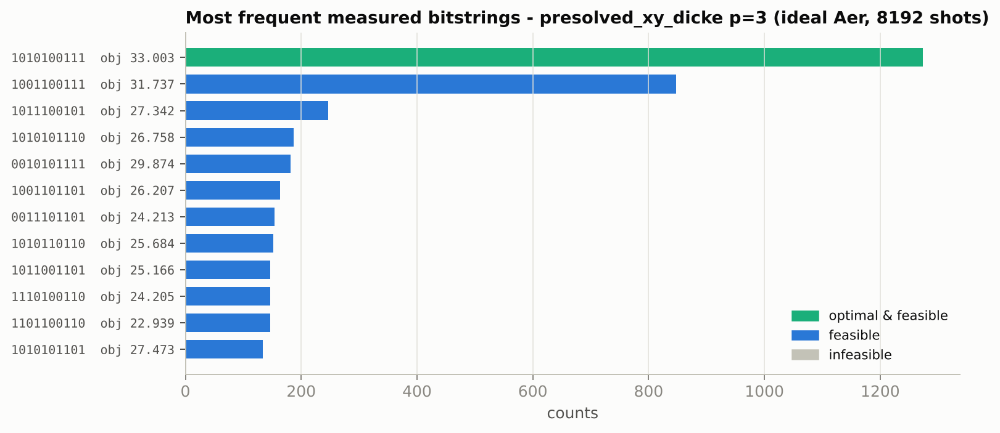
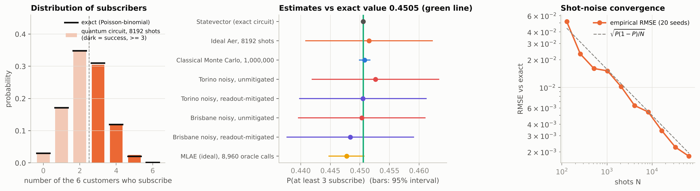
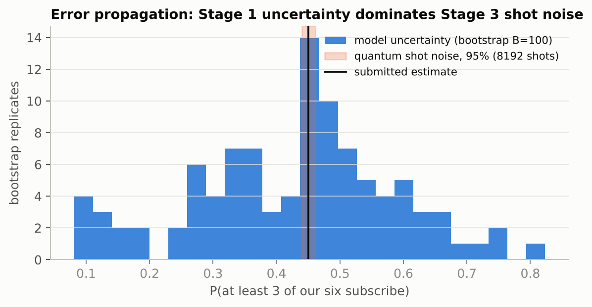

# Hybrid Quantum-Classical Term Deposit Campaign Pipeline

**Final answer:** contact **C0081, C0031, C0079, C0170, C0087, C0397**. The probability that **at least three of them subscribe is 0.4505** (exact). The quantum circuit estimate is 0.4515 ± 0.0055 from 8,192 shots.

| Result file (repo root) | Contents |
|---|---|
| `stage1_results.csv` | 100 test customers: `customer_id`, predicted probability, rank, top-10 flag |
| `stage2_results.csv` | Top 10 with their inputs, qubit index, quantum and exact selections, budget and capacity totals, objective, best bitstrings, gap |
| `stage3_results.csv` | The six customers: qubit order, probabilities, RY angles, measurement counts, quantum, exact and Monte Carlo results, noisy results, errors |

> **Data release.** We use the organisers' updated workbook, in which `Stage1_Test` includes `customer_id`. The first release did not. The pipeline validates that the 100 test IDs are exactly those absent from `Stage1_Train` and present in `Stage2_Data`, each appearing once. The mapping used is also written to `data/test_customer_ids_used.csv`.

---

## 1. Pipeline at a glance

```
Stage1_Train (300) ─► nested CV of 8 models ─► pre-declared rule ─► production model ─► P(subscribe) for 100 test customers
                                                                                        │ top 10 (ties: lower ID first)
Stage2_Data + constraints ─► expected net value v_i = p_i·D_i − c_i ─► QUBO / constraint-preserving QAOA ─► 6 customers
                                                                       └─ brute force (1024 assignments) = exact reference
six p_i ─► 6-qubit RY circuit ─► P(≥3 ones) ─► vs exact Poisson-binomial, Monte Carlo, noisy hardware models
         └─ bootstrap of the training data pushes Stage 1 uncertainty through Stages 2 and 3
```

Each stage reads the previous stage's file, so the `customer_id` chain is explicit: `stage1_predictions.csv` → `stage2_candidates.csv` → `stage3_qubits.csv`.

### What is quantum and what is classical

| Component | Quantum | Classical |
|---|---|---|
| Stage 1 | Fidelity quantum-kernel LR (IQP map, 6 qubits). Data re-uploading VQC (6 qubits, 2 layers). Hybrid ensemble | Feature engineering, LR baseline (**the chosen production model**), random forest, RBF-kernel control, all CV and tuning |
| Stage 2 | QAOA in three formulations, sampled on Aer (ideal and noisy) | QUBO construction and presolve, COBYLA outer loop, decoding and feasibility check, brute-force reference |
| Stage 3 | RY state preparation and sampling. Noisy runs with readout mitigation. Amplitude-estimation extension | Exact Poisson-binomial, Monte Carlo, bootstrap error propagation |

**We make no quantum-advantage claim.** Every quantum result is compared with an exact or classical reference, and those references are as good as or better than the quantum methods on this problem size.

---

## 2. Stage 1 – subscription prediction

**Data.** There are 300 training customers with 35 positives (11.7%). Call `duration` was removed. There are no missing values, and every test category also appears in training.

**Features** (fitted inside each training fold, never using labels): 14 compact numeric features.

- Age and (age−40)²
- Signed log of balance, day, and log of campaign
- A "previously contacted" flag and log pdays / log previous
- Flags for `poutcome` = success / failure, contact = unknown, housing loan and personal loan
- `month_is_mode`, a flag for the training fold's most frequent month, chosen by frequency rather than by target

Each pipeline then standardises the features and keeps the top *k* with an L1-logistic selector, all fitted in-fold.

**Models.**

| Family | Model |
|---|---|
| Classical baseline | Logistic regression on the selected *k* ∈ {4, 6, 8} features, C ∈ {0.1, 0.3, 1} |
| Classical | Random forest (500 trees, min leaf 5) |
| Classical control | Gaussian-kernel logistic regression on the same 6 features as the quantum models. This separates "kernel method" from "quantum" |
| **Quantum kernel** | Fidelity kernel k(x,x′) = \|⟨φ(x)\|φ(x′)⟩\|². The map is IQP-style: [H · RZ(2x_i) · RZZ(2x_i x_{i+1})]×2 on 6 qubits, with nearest-neighbour entanglement so it needs no SWAPs. Inputs are standardised features × **bandwidth γ** ∈ {0.15, 0.3, 0.45}, which counters exponential kernel concentration. The kernel is computed with `qiskit-machine-learning`'s `FidelityStatevectorKernel`. The classifier is **kernel logistic regression**, which optimises log-likelihood directly so the probabilities need no Platt step. C ∈ {1, 3, 10} |
| **Variational (QNN)** | Data re-uploading circuit, 6 qubits × 2 layers. Each layer applies RY(w·x+b) then RZ(θ) on every qubit, followed by a CZ chain. The readout is p = σ(Σ a_q⟨Z_q⟩ + c), with 43 parameters (36 in the circuit, 7 in the readout). Trained with L-BFGS on cross-entropy with L2 on the input weights (λ ∈ {0.03, 0.1, 0.3}). Gradients are exact, via **adjoint differentiation** on a vectorised statevector simulator. That simulator matches Qiskit `Statevector` to 1e-16 and finite differences to 1e-10 (see `tests/`). With a single layer the CZ commutes with Z-measurement, so the model would be unentangled; two layers are needed for entanglement to matter |
| **Hybrid** | Equal-weight average of the LR, quantum-kernel and VQC probabilities |

**Validation protocol.** We ran **nested** cross-validation on training data only.

- **Outer loop:** RepeatedStratifiedKFold, 5 folds × 5 repeats, seed 42.
- **Inner loop:** 5-fold CV that tunes each model on log loss.
- **Metrics:** computed on the pooled 300 out-of-fold predictions per repeat, then reported as mean ± sd over repeats.
- **Leakage audit:** an early prototype chose features on the full training set and inflated AUC by about 0.03. We moved selection inside the folds and report only the honest nested numbers.
- **Test set:** predicted exactly once, after the pipeline was final.

**Nested CV results** (higher is better except Brier and log loss):

| Model | ROC-AUC | PR-AUC | Brier | Log loss | Prec@10% | Recall@10% | Calib. slope |
|---|---|---|---|---|---|---|---|
| **LR engineered (chosen)** | 0.686 ± 0.015 | **0.305 ± 0.013** | **0.0943** | **0.3348** | 0.267 | 0.229 | **0.91** |
| Hybrid ensemble (LR + QK + VQC) | **0.690 ± 0.015** | 0.300 ± 0.019 | 0.0947 | 0.3349 | 0.280 | 0.240 | 0.86 |
| VQC (quantum) | 0.684 ± 0.020 | 0.296 ± 0.021 | 0.0950 | 0.3414 | 0.267 | 0.229 | 0.71 |
| Quantum kernel LR (quantum) | 0.684 ± 0.022 | 0.273 ± 0.032 | 0.0980 | 0.3411 | **0.287** | **0.246** | 0.72 |
| RBF kernel LR (classical control) | 0.676 ± 0.018 | 0.276 ± 0.017 | 0.0966 | 0.3415 | 0.227 | 0.194 | 0.73 |
| Random forest | 0.637 ± 0.013 | 0.244 ± 0.036 | 0.1003 | 0.3510 | 0.273 | 0.234 | 0.63 |
| LR on all one-hot fields (reference) | 0.571 ± 0.029 | 0.168 ± 0.030 | 0.1026 | 0.3583 | 0.187 | 0.160 | 0.79 |
| Base rate (reference) | 0.500 | 0.117 | 0.1031 | 0.3602 | – | – | – |



**Model choice.** The rule (`config.SELECTION_*`) picks the lowest mean log loss, because Stages 2 and 3 use the probabilities as numbers. Any model within one standard error of the best (SE = 0.0017) counts as tied, and ties go to the simplest model. We added the tie clause after our first run, and it does not change the outcome: the original rule also chose LR. Without it, the 0.0001 gap between LR and the hybrid could flip under floating-point differences on another machine. The rule selects **logistic regression**. The hybrid ensemble is statistically tied: the paired log-loss difference is +0.00004 ± 0.0020 over repeats. Both quantum models reach the classical baseline on ROC-AUC. The quantum kernel edges its matched classical RBF control on ROC-AUC and precision@10% but not on PR-AUC or Brier. Neither quantum model beats the baseline overall. We report that as it is; the production model is the one the original rule chose.

**Production model.** Six features were selected, with C = 0.1. Standardised coefficients:

| Feature | Coefficient |
|---|---|
| Previous campaign succeeded | +0.38 |
| Contacted in May (modal month) | −0.40 |
| Signed log balance | +0.27 |
| Later day of month | −0.24 |
| Previous campaign failed | −0.20 |
| Age | −0.02 |

The model-implied expected number of subscribers in the top 10 is 3.15.

**Top 10 (Stage 2 candidates):**

| Rank | ID | p | Rank | ID | p |
|---|---|---|---|---|---|
| 1 | C0081 | 0.6587 | 6 | C0170 | 0.1876 |
| 2 | C0031 | 0.6525 | 7 | C0318 | 0.1819 |
| 3 | C0079 | 0.5429 | 8 | C0087 | 0.1715 |
| 4 | C0183 | 0.2109 | 9 | C0128 | 0.1713 |
| 5 | C0378 | 0.2056 | 10 | C0397 | 0.1694 |

---

## 3. Stage 2 – constrained selection

The goal is to maximise Σ v_i x_i, where v_i = p_i·D_i − c_i, subject to:

- Σx_i = 6
- Σc_i x_i ≤ 25
- Σh_i x_i ≤ 22

### Constraint analysis

For these candidates the **six largest contact costs sum to 4+4+3+3+3+2 = 19 ≤ 25**. Costs never exceed 4, so the budget can never bind for *any* candidate set (6×4 = 24). The **six largest capacity units sum to 3+3+3+3+2+1 = 15 ≤ 22**. Both inequalities are therefore implied by Σx = 6, and all C(10,6) = 210 six-subsets are feasible. Brute force confirms this by enumerating all 1,024 assignments.

We kept the general machinery and compared three formulations. The code adds slack registers automatically whenever a constraint can bind.

| Formulation | Qubits | Constraint handling | Penalty weight (provable, never uses the optimum) |
|---|---|---|---|
| **Full QUBO** | 18 = 10 decision + 4 budget slack + 4 capacity slack | (Σx−6)² + (Σc x + s_B − 25)² + (Σh x + s_H − 22)². Slack registers use a **bounded binary encoding** covering exactly [0, U], where U = limit − smallest possible usage by six customers: budget U = 25 − 10 = 15 and capacity U = 22 − 7 = 15, each with weights (1,2,4,8). The encoder switches to a bounded final weight (e.g. 1,2,4,8,1 for U = 16) when U is not 2^m − 1 | A = 1.5·Σ\|v_i\| = 54.75. Residuals are integers, so any violation costs at least A > Σv⁺ − V* |
| **Presolved QUBO** | 10 | Cardinality penalty only, after the redundancy proof | A = 1.5·max\|v_i\| = 15.04. Moving k bits off weight 6 gains at most k·max\|v\| but costs A·k² |
| **Constraint-preserving QAOA** | 10 | **Dicke state \|D¹⁰₆⟩** (deterministic Bärtschi–Eidenbenz preparation) and a parity-ring **XY mixer**. Hamming weight is conserved, so Σx = 6 holds *by construction* | None needed |

**Verification.** The QUBO ground state decodes to the constrained optimum in every formulation. This was checked exhaustively: 262,144 states for the 18-qubit QUBO, with an energy gap of 1.134 to the next distinct solution, and 1,024 states for the presolved QUBO. The Ising mapping is exact to 1e-12.

**Optimiser.**

- **Search:** COBYLA on CVaR₀.₂₅ of the normalised energy (Barkoutsos et al. 2020).
- **Starting points:** INTERP warm starts from depth p−1 (Zhou et al. 2020), a linear annealing ramp, and random starts. That gives 8 restarts with seed 42 (3 for the 18-qubit formulation).
- **Simulation:** the outer loop uses an exact statevector simulator. The final parameters run as genuine **Qiskit circuits on Aer** with 8,192 shots (seed 1234). The simulator and the Qiskit circuits agree to 1e-15 (`tests/`).

**Decision rule** (fixed in advance; never uses the brute-force answer): take the feasible sampled bitstring with the highest objective across all ideal-shot runs.

### Results

| Formulation | p | P(optimum), exact | P(optimum), 8,192 shots | P(feasible) | Approx. ratio \| feasible |
|---|---|---|---|---|---|
| Full QUBO (18q) | 2 | 0.0010 | 0.0011 | 0.30 | 0.60 |
| Presolved QUBO (10q) | 3 | 0.0135 | 0.0109 | 0.65 | 0.71 |
| **Dicke + XY (10q)** | 1 / 2 / **3** | 0.060 / 0.113 / **0.157** | 0.059 / 0.111 / **0.156** | **1.00** | 0.75 / 0.76 / 0.77 |
| *Uniform over the 210 six-subsets* | – | 0.0048 | – | 1.00 | – |
| *Uniform over 1,024 bitstrings* | – | 0.00098 | – | 0.205 | – |

**Selected:** C0081, C0031, C0079, C0170, C0087, C0397.

- Decision-register bitstring `1010100111` (q9…q0), measured 1,274 times out of 8,192, the most frequent outcome. The runner-up selection was measured 848 times.
- Objective **33.003**, contact cost 12 / 25, capacity 10 / 22.
- **Exact optimum 33.003: gap 0** (the second-best subset scores 31.869).
- At p = 3 the constraint-preserving QAOA samples the optimum **33× more often than uniform sampling** over feasible subsets.
- Optimised parameters (normalised units, circuit angles in `results/stage2_details.json`): γ = (−0.740, −1.504, 0.356), β = (0.786, 0.753, −0.514).

**Penalty design matters.** A sweep of the presolved penalty at p = 3 shows the ground state stays correct for every A ≥ 0.25·max|v|. P(optimum), however, rises from 0.005 at A = 8·max|v| to 0.117 at A = 0.25·max|v|: large penalties flatten the objective landscape QAOA has to resolve. The smallest *valid* penalty depends on the instance, and finding it essentially requires solving the instance, so production uses the provable bound. This is why the full 18-qubit QUBO performs no better than random: its penalties dominate the energy scale.




**Hardware-like execution.** Transpiled with the optimisation level 3 preset, `seed_transpiler` = 42. SWAPs are counted after routing.

| Circuit | Backend | Logical → physical qubits | Depth (orig → transpiled) | 2q gates (orig → native) | SWAPs | P(opt) noisy → readout-mitigated |
|---|---|---|---|---|---|---|
| Dicke + XY, p = 3 | FakeTorino (CZ) | 10 → 12 | 75 → 1,298 | 117 + 30 CCRY → 656 | 116 | 0.0096 → 0.0113 |
| Dicke + XY, p = 3 | FakeBrisbane (ECR) | 10 → 10 | 75 → 2,230 | 117 + 30 CCRY → 660 | 118 | 0.0028 → 0.0030 |
| Presolved QUBO, p = 3 | FakeTorino | 10 → 10 | 44 → 575 | 135 → 453 | 115 | 0.0043 → 0.0051 |
| Presolved QUBO, p = 3 | FakeBrisbane | 10 → 10 | 44 → 915 | 135 → 436 | 114 | 0.0015 → 0.0015 |
| Full QUBO, p = 2 | FakeTorino / FakeBrisbane | 18 → 18 | 52 → 1,191 / 1,401 | 274 → 1,200 / 1,096 | 276 / 270 | not run (too deep to be informative) |

Results for p = 1 and p = 2 under noise are in `results/stage2_runs.csv`. On Torino, P(opt) for the XY formulation still rises with depth under noise (0.0048 → 0.0074 → 0.0096), because most of the depth comes from the Dicke preparation. On the noisier Brisbane model it peaks at p = 2.

**Honest reading of the noisy runs.** Noise destroys Hamming-weight conservation: the XY formulation's feasible fraction drops from 1.00 to 0.20–0.25, close to the 0.205 of random bits. Every noisy run still *contains* the optimum among its 8,192 samples, but uniform random sampling would too, with probability 1 − (1 − 1/1024)^8192 ≈ 99.97%. So finding the optimum under noise is not evidence of quantum performance; P(optimum) against the baselines is the metric that matters.

---

## 4. Stage 3 – P(at least 3 of the 6 subscribe)

**Circuit.** One qubit per customer: RY(θ_i)|0⟩ with θ_i = 2·arcsin(√p_i), so P(1) = p_i. The qubits are independent, matching the independence assumption. Measure all six and count outcomes with Hamming weight ≥ 3.

**Qubit order** is ascending Stage 1 rank. Qiskit bitstrings are little-endian: the rightmost character is q0. Per-qubit marginals were checked against p_i in that order (maximum sampled deviation 0.0102 at 8,192 shots).

| Qubit | q0 | q1 | q2 | q3 | q4 | q5 |
|---|---|---|---|---|---|---|
| Customer | C0081 | C0031 | C0079 | C0170 | C0087 | C0397 |
| p_i | 0.6587 | 0.6525 | 0.5429 | 0.1876 | 0.1715 | 0.1694 |
| θ_i (rad) | 1.8937 | 1.8807 | 1.6566 | 0.8960 | 0.8539 | 0.8483 |
| Shots measuring 1 (of 8,192) | 5,356 | 5,325 | 4,531 | 1,548 | 1,420 | 1,443 |

| Method | P(≥3) | Absolute error vs exact |
|---|---|---|
| **Exact Poisson-binomial** (dynamic programming) | **0.450548** | – |
| Statevector of the circuit | 0.450548 | 6e-17 |
| **Quantum, ideal Aer, 8,192 shots** (seed 5678) | **0.451538** (3,699 successes), SE 0.0055, Wilson 95% CI [0.4408, 0.4623] | 0.0010 (z = 0.18) |
| Classical Monte Carlo, 10⁶ draws (seed 2468) | 0.450809 | 0.00026 |
| Noisy FakeTorino: unmitigated → readout-mitigated | 0.452637 → 0.450525 | 0.0021 → 0.00002 |
| Noisy FakeBrisbane: unmitigated → readout-mitigated | 0.450317 → 0.448387 | 0.0002 → 0.0022 |

**Circuit metrics.**

- Logical: 6 qubits, depth 1, six RY gates.
- Transpiled to either backend: 6 physical qubits, depth 5, 24 single-qubit native gates (sx/rz), **0 two-qubit gates, 0 SWAPs**.

**Noise and mitigation.**

- Gate noise is negligible here, so readout error dominates (per-qubit assignment fidelity ≈ 0.99).
- Readout errors partly cancel for a weight-threshold statistic. Both unmitigated and mitigated estimates lie within one shot-noise standard error of the exact value, so mitigation helps on Torino and not on Brisbane *within statistical noise*.
- Mitigation is the tensored inverse of per-qubit confusion matrices, measured with calibration circuits on the same noisy simulator, then projected back onto the probability simplex. Both unmitigated and mitigated numbers are reported.

**Shot-noise convergence.** The empirical RMSE over 20 seeds per shot count follows √(P(1−P)/N) from 128 to 65,536 shots (figure, right panel).

**Extension: amplitude estimation (exploratory, ideal simulation only).**

- **Oracle:** a 10-qubit circuit that *coherently* counts subscribers in a 3-qubit register and flags weight ≥ 3. A flag of 1 is equivalent to c₂ ∨ (c₁ ∧ c₀), and the two terms are mutually exclusive. It is built from standard gates only. Its counter register reproduces the Poisson-binomial distribution exactly.
- **Method:** maximum-likelihood amplitude estimation with Grover powers {0, 1, 2, 4, 8} at 256 shots each, i.e. 8,960 oracle calls.
- **Ideal result:** **0.4477 ± 0.0015** (Fisher information; error 0.0028 vs exact). Direct sampling with the same 8,960 calls has standard deviation 0.0053, so this is the textbook quadratic speed-up in shots.
- **Under FakeTorino noise:** the Q¹ circuit is depth 3,126 with 1,287 two-qubit gates, and the estimate collapses to 0.495 (error 0.045). On current hardware, direct sampling is the right choice.



---

## 5. Error analysis and propagation across stages

The stages are linked, so Stage 1 error flows downstream. We refit the production model on **100 stratified bootstrap resamples** of the training data (hyper-parameters frozen, seed 2026). For each replicate we re-predicted the test set and recomputed the top 10, the *exact* optimal six and P(≥3).

- **Model uncertainty dwarfs quantum sampling error.** For our six, P(≥3) has median 0.455 and a **90% interval of [0.12, 0.67]** (sd 0.162). The Stage 3 shot noise is 0.0055, about **29× smaller**. More shots would not improve the business answer; more labelled data would.
- **Three anchors, three swing slots.**
  - C0081, C0031 and C0079 are in the top 10 in 99% of replicates, and are selected in 95%, 95% and 99% of them.
  - The other three slots rotate among customers with p ≈ 0.14–0.21. C0170 is selected in 43%, C0397 in 27% and C0087 in 24% of replicates. C0256 (rank 23, but with high deposit value) is selected in 23%. The exact same six recur in 10% of replicates.
- **Stage 2's decision margins are small relative to Stage 1 error.** The optimum beats the runner-up by 1.13 in expected net value. Re-optimising the six inside each bootstrap replicate gives median P(≥3) = 0.50 [0.20, 0.71].
- **Stage 1 error sources.**
  - Only 35 positives.
  - The strongest pre-call signal (`poutcome = success`) is rare: 10 training customers.
  - The ranking leans on four strong signals (May, previous outcome, balance, day), so customers without a previous campaign are hard to separate.
  - Calibration is good overall (slope 0.91), but in a 300-row sample the reliability curve is noisy.



---

## 6. Business recommendation

1. **Contact C0081, C0031, C0079, C0170, C0087 and C0397.**
   - Expected subscribers: 2.38.
   - P(≥3) = 45%: the conversion target is slightly worse than a coin flip, not a safe bet.
   - Expected net value: 33.0.
   - The plan uses 12 of 25 budget and 10 of 22 capacity.
2. **The cardinality rule, not budget or capacity, is the binding constraint.**
   - Eight of the ten candidates have positive expected net value (C0378 and C0128 are negative).
   - If the business can relax "exactly 6", adding C0183 (+0.95) raises both expected value and P(≥3) at no constraint cost.
3. **Treat the first three as firm and the last three as interchangeable.**
   - The swing slots are within model error of each other.
   - Use secondary criteria (segment mix, lower cost) to choose among them, or rotate them across waves and learn from the outcomes.
4. **Invest in data, not shots.** The cheapest way to tighten the 0.12–0.67 interval is to record this campaign's outcomes and retrain.
5. **Quantum position.**
   - The quantum components are validated end to end and reproduce exact results in ideal simulation.
   - Constraint-preserving QAOA is clearly the right formulation: against uniform sampling over feasible subsets it is 33× better, the presolved penalty QUBO about 3×, and the full QUBO no better.
   - At this scale, classical methods (sorting, brute force, exact convolution) are exact and instantaneous. Current noise levels erase most of QAOA's advantage over random sampling.

---

## 7. Limitations

- **Small data.** With 300 rows the CV standard deviations are comparable to the differences between models.
- **Simulation only.** All quantum runs are simulations: ideal Aer and noise models from IBM fake backends (calibration snapshots). No real QPU was used.
- **How QAOA parameters were found.** They were optimised with exact simulation, which does not scale. On hardware one would use shot-based CVaR with SPSA or parameter transfer.
- **Presolved instance is easy classically.** It is cardinality-constrained and linear, so sorting by v solves it. QAOA is demonstrated, not needed.
- **Amplitude-estimation oracle scope.** It is specialised to n ≤ 6 and k = 3.
- **Independence assumption.** Stage 3 assumes customers respond independently, as the brief specifies. Correlated responses (shared month or segment) would widen the distribution.

---

## 8. Reproducibility

```bash
pip install -r requirements.txt         # Python 3.13; exact versions pinned
python run_all.py                       # all stages, ~25 min on 2 CPU cores -> results/ + three root CSVs
python run_all.py --quick               # smoke test (~10 min) -> results_quick/ only; never touches results/
python run_all.py --stages 2 3          # reuse Stage 1 output
python -m pytest -q tests               # 12 exactness checks (simulators vs Qiskit, QUBO, Dicke, oracle, tie rule)
python notebooks/build_notebook.py --execute   # rebuilds the executed walkthrough notebook
python package_submission.py            # zips the folder for submission
```

| Item | Value |
|---|---|
| Seeds | global / VQC init / QAOA init 42 · outer CV 42 · inner CV 7 · transpiler 42 · QAOA sampler 1234 · Stage 3 sampler 5678 · noisy simulations 91011 · Monte Carlo 2468 · bootstrap 2026 (`src/qcampaign/config.py`, written to `results/environment.json`) |
| Packages | qiskit 2.6.2, qiskit-aer 0.18.2, qiskit-ibm-runtime 0.52.0, qiskit-machine-learning 0.9.1, scikit-learn 1.9.1, numpy 2.5.3, scipy 1.18.1, pandas 3.0.5 (`requirements.txt`) |
| Simulators | `AerSimulator` (automatic method) for ideal runs. `AerSimulator.from_backend(FakeTorino / FakeBrisbane)` for noisy runs. Statevector for exact checks |
| Shots | QAOA 8,192 · Stage 3 8,192 · readout calibration 8,192 per state · amplitude estimation 256 per Grover power · Monte Carlo 10⁶ |
| Determinism | Fully seeded; a clean rerun reproduced every result file byte-for-byte on the same platform (section 9) |

**Repository layout.**

| Path | Contents |
|---|---|
| `src/qcampaign/` | `config`, `data`, `features`, `metrics`, `models/{classical, quantum, vqc, base}`, `stage1`, `qaoa`, `stage2`, `stage3`, `hardware`, `uncertainty`, `figures`, `pipeline` |
| `results/` | Detailed outputs: CV metrics and per-repeat values, out-of-fold predictions, model card, QUBO coefficients, optimisation traces, transpilation reports, measurement counts, penalty sweep, Stage 3 details, bootstrap draws, figures, run logs |
| `notebooks/end_to_end_pipeline.ipynb` | Executed walkthrough with live verification cells |
| `tests/` | Exactness tests |
| `presentation/` | Slide deck (PDF / PPTX) |

## 9. Verification log

- **Determinism.** On the first data release, a full clean rerun (`rm -rf results; python run_all.py`, 23 min on 2 cores) reproduced all 48 result files byte-for-byte, figures included (JSON compared without timing fields). The final results come from a further clean run on the updated release (22 min). Its Stage 1 CV metrics are byte-identical to the earlier runs, as expected, since the training data is unchanged.
- **Cross-platform note.** Results were produced on Linux x86_64 with Python 3.13 and the pinned packages. Other platforms (for example Apple Silicon) can differ in the last decimals through floating-point and BLAS differences. The selection rule's tie clause keeps the Stage 1 model choice stable under such differences.
- **Smoke test.** `--quick` completes end to end. It uses one CV repeat, so its choices can differ from the full run; it writes only to `results_quick/`.
- **Live checks.** The executed notebook refits the production model (max \|Δp\| = 5e-7, the files' rounding; identical ranking), re-runs the brute force and the 2^18-state ground-state check of the full QUBO, and recomputes the exact P(≥3).
- **Tests.** All 12 tests pass:
  - VQC adjoint gradient and simulator vs Qiskit
  - Dicke states for (4,2), (6,3), (10,6)
  - Bounded slack coverage
  - QUBO ground state and Ising exactness
  - QAOA simulator vs Qiskit for both mixers, including Hamming-weight conservation
  - Stage 3 circuit and oracle exactness
  - Tie-break rule
  - Poisson-binomial
- **Feasibility.** The Stage 2 selection has six unique IDs, all from our own top 10; cost 12 ≤ 25 and capacity 10 ≤ 22.
- **No test labels exist in the release, and nothing was tuned on the test set.**
- **ID integrity.** The test IDs from the updated release are validated against Stage 1 training and Stage 2 data. Each result file is keyed on `customer_id`, and the Stage 1 → 2 → 3 chain is checked in the notebook.
